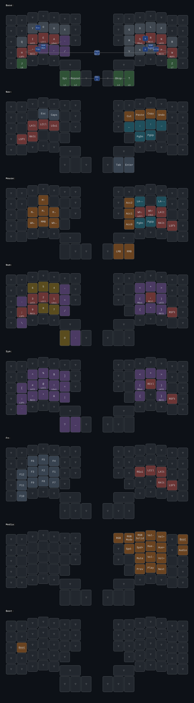

# My Moonlander and Ferris keymap

Keymaps for two keyboards that share one layout:

- **ZSA Moonlander** (`RgoVP/`): edited in [Oryx](https://configure.zsa.io/moonlander/layouts/RgoVP/latest), extended with custom QMK code.
- **splitkb Halcyon Ferris rev1** (`ferris/`): 3x5+2, generated from the Moonlander layout. The Moonlander layout only uses 34 keys, so the Ferris gets the same layout.

Based on [poulainpi/oryx-with-custom-qmk](https://github.com/poulainpi/oryx-with-custom-qmk), which merges Oryx's graphical layout editing with hand-written QMK features and builds the firmware in GitHub Actions. See ZSA's [blog post](https://blog.zsa.io/oryx-custom-qmk-features) for the background.

## Layout



The Ferris version is in [`docs/ferris-keymap.svg`](docs/ferris-keymap.svg). Both SVGs are redrawn by CI whenever the layout changes.

Custom QMK features on top of Oryx:

- **Repeat key** on the left thumb: tap to repeat the last key, hold for layer 2. Repeat also replays AltGr dead keys, so after AltGr+~ then o (õ), it types õ again instead of o.
- **Chordal Hold** for the home-row mods.
- **Combos** for Enter, Esc, Tab, Caps Word, ä/ö and one-shot Hyper/Meh.

## How it works

- The `oryx` branch holds raw Oryx exports. `main` holds those merged with the custom QMK code.
- **Fetch and build layout** (run by hand): downloads the latest layout from Oryx, commits it to `oryx`, merges it into `main`, and builds the Moonlander firmware with ZSA's QMK fork. It then runs **Build Ferris layout**.
- **Build Ferris layout** (runs on pushes touching the layout, after every Oryx fetch, or by hand):
  1. Regenerates `ferris/` from `RgoVP/` with `ferris/generate.py`.
  2. Redraws both SVGs.
  3. Commits any changes back to `main`.
  4. Builds the Ferris firmware with upstream QMK.

The generated Ferris files (`keymap.c`, `config.h`, `i18n.h`) are never edited by hand. Only `ferris/rules.mk` is. The generator:

- moves the Moonlander's lower pinky columns up a row,
- renames keycodes that upstream QMK has renamed,
- drops keys outside the 34, listing them as it goes,
- turns RGB keys into `KC_NO`, since the Ferris has no LEDs.

## Changing the layout

1. Edit the layout in Oryx and click **Compile this layout**. Anything you type in **Some notes about what you changed** becomes the commit message.
2. Run **Fetch and build layout** from the Actions tab.
3. `git pull` to get the merge and the regenerated Ferris files.

For QMK features Oryx can't do, edit `RgoVP/config.h`, `keymap.c` or `rules.mk` on `main` and push. Keep hand-written code out of the parts Oryx regenerates (the keymap array, combos, `DUAL_FUNC_*`), or the next Oryx merge will conflict. Mirror new `rules.mk` features in `ferris/rules.mk`.

## Flashing

Download the firmware from the workflow run's artifacts.

**Moonlander** (`zsa_moonlander_reva_RgoVP.bin`, from *Fetch and build layout*): flash with [Keymapp](https://www.zsa.io/flash#flash-keymap).

**Ferris** (`splitkb_halcyon_ferris_rev1_mirror.uf2`): each half is flashed separately with the same file. No flashing tool is needed:

1. Plug the half you want to flash into the computer with a data-capable USB cable. The cable between the halves can stay connected.
2. Double-tap that half's reset button. It shows up as a USB drive called `RPI-RP2`.
3. Copy the `.uf2` onto the drive. The half reboots by itself once the copy finishes.
4. Repeat for the other half.

## Drawing the keymap locally

```sh
nix run    # regenerates ferris/ and redraws docs/keymap.svg + docs/ferris-keymap.svg
```

## Credits

Workflow and template by [Pierre Poulain](https://github.com/poulainpi/oryx-with-custom-qmk) (MIT, see `LICENSE.md`). The [Oryx Chrome extension](https://chromewebstore.google.com/detail/oryx-extension/bocjciklgnhkejkdfilcikhjfbmbcjal) by [@nivekmai](https://github.com/nivekmai) can trigger the workflows from inside Oryx.
